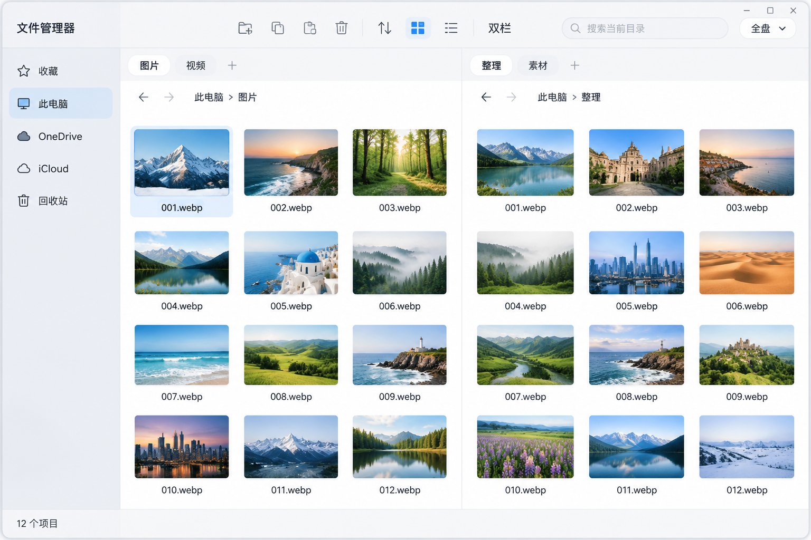

# 文件管理器概念图

Spec：[Issue #1：Rust + Slint 文件管理器：产品规格与三阶段交付地图](https://github.com/rt-game-440/slint-file-manager/issues/1)。两者冲突时以 Spec 为准。

状态：用户于 2026 年 11 月 7 日明确通过 A2，淘汰 B3、C2。当前唯一通过并归档的视觉方向是 A2；本文作为第一阶段主界面的实现参考，不表示界面或性能已经实现。

## A2：macOS 灵感的轻盈双栏

### 回答的开放问题

- 采用融合标题与工具栏的紧凑顶部结构，减少主界面占用的纵向层级。
- 采用柔和浅色侧栏、近白内容区、低对比页签与克制蓝色强调，营造轻盈、细腻的桌面视觉。
- 双栏以等宽网格呈现，保留两组独立标签和路径导航，兼顾媒体浏览与文件整理。

### 实现时照做

| 部分 | 已认可的视觉依据 |
| --- | --- |
| 整体结构 | 左侧固定导航区，右侧两个清楚分隔的浏览面板；图示状态下等宽排列。 |
| 窗口顶部 | 标题、常用图标操作、视图切换、双栏入口与搜索整合为一条紧凑区域；窗口最小化、最大化、关闭仍位于右上角。 |
| 面板组织 | 每个浏览面板拥有独立标签带，标签下方各自显示后退／前进与路径导航；不能将两侧标签合并为一个全局标签组。 |
| 导航侧栏 | 柔和浅灰底、统一细线图标、清晰短文字，当前项使用淡蓝圆角背景。保留收藏、此电脑、OneDrive、iCloud、回收站入口。 |
| 内容展示 | 简洁图片网格与短文件名；图片本身是主体，减少厚重卡片、密集边框和装饰阴影。 |
| 选择与层级 | 文件选中态采用克制蓝色描边／浅蓝底；标签使用低对比表面与字重区分，面板边界用细分隔线表达。 |
| 排版与配色 | 采用清晰中文无衬线字体、适中小字号、近黑文字、白灰层次与少量蓝色强调，保持图中的轻盈感与留白节奏。 |
| 搜索入口 | 搜索框与全盘范围入口始终可见；实际默认范围仍为当前目录及子目录，按 Spec 明确当前搜索范围。 |

### 不作依据

- 图中的山景、海岸、建筑等照片、`001.webp` 等名称、目录名称和“12 个项目”等具体数据均为生成占位，不是用户文件或新的数据规则。
- 每栏三列四行、精确像素宽高、边距、图标尺寸和圆角值不是固定设计 token；需要随窗口大小、文字缩放与实际内容布局。等宽是选定图示的初始布局参考，不限制规格要求的单栏切换。
- 图中的图标与字体外观不是已选定或已授权的资产包，应使用适合项目的可用资源实现相同视觉语言。
- 雾面感是认可的视觉效果，不强制采用真实透明、模糊或特定平台 API；具体实现不得牺牲规格中的性能和可读性。
- 两侧当前标签的相似样式不能替代明确的活动面板和键盘焦点。交互原型需验证焦点、悬停、禁用、长路径、空目录和加载／错误状态。
- 顶部图标、状态条和搜索控件的画法不能代替操作语义。动作作用于哪个面板、状态条统计口径与搜索当前范围必须按实际行为表达。
- 静态图没有展示的预览、标准文件操作、云盘状态、NanaZip 菜单和会话恢复仍以 Spec 为准；通过本图不删减这些能力，也不证明兼容性或速度目标已经达到。
- macOS 灵感只适用于视觉语言。应用目标平台仍为 Windows 10／11 x64，不增加 macOS／Linux 支持、Finder 克隆、Dock 或 Apple 品牌要求。

### 用户意见与追溯

- 用户方向要求：“能不能做 linxu/macos 系那种风格？”
- 用户对本图的审核原文：“通过”。同轮 B3、C2 的审核原文均为“淘汰”。
- 提示词：[round-2/jobs.json](round-2/jobs.json) 中的 `A2`。
- 图像：[round-2/A2.png](round-2/A2.png)，1536×1024 PNG。
- 自检与审核记录：[round-2/review.md](round-2/review.md)。
- 第一轮图片未获得通过结论，只保留为探索记录；第二轮已淘汰图同样仅供追溯。不得将它们作为与 A2 并列的实现方向。
